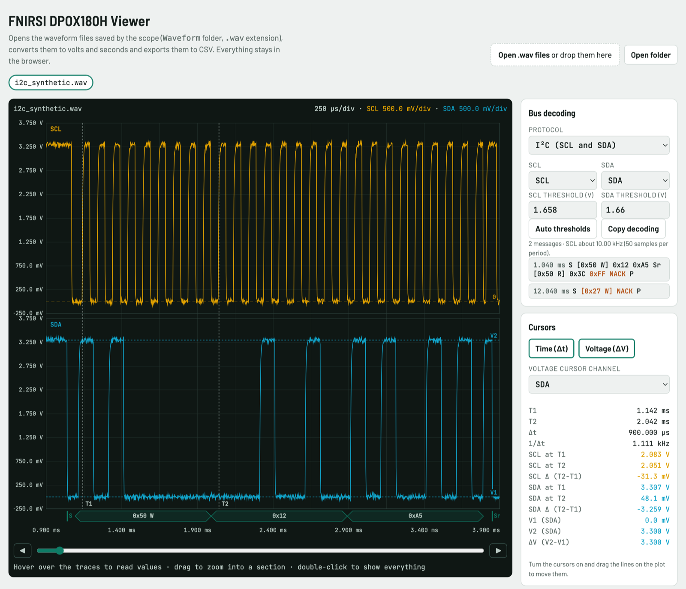

# FNIRSI DPOX180H: scaricamento, visore e decodifica dei file

*English version: [README.md](README.md). L'interfaccia del visore è in inglese.*

Strumenti per l'oscilloscopio portatile FNIRSI DPOX180H (firmware V40), testati su macOS:

- **Scaricamento:** copia i file dallo strumento via USB senza i blocchi che si hanno con il Finder.
- **Lettura dei file:** decodifica correttamente le forme d'onda salvate (`.wav`) e le esporta in CSV.
- **Visore nel browser:** galleria con miniature, scale come sullo strumento, cursori, zoom e decodifica dei bus **I²C**, **UART** e **1-Wire**.



**Non affiliato con FNIRSI.** Progetto indipendente, nato per leggere i propri file di misura. FNIRSI è un marchio del rispettivo proprietario.

## Requisiti

- Python 3.9 o successivo, senza librerie esterne.
- macOS per lo scaricamento dallo strumento: usa `mount`, `diskutil` e le letture senza cache. La lettura dei file e il visore funzionano ovunque.
- Un browser recente.

## Uso

Sullo strumento: impostazioni → **USB sharing**, poi collega il cavo.

```bash
python3 fnirsi.py viewer
```

Si apre il visore nel browser, con la galleria dei file presenti sullo strumento.

- **Galleria:**
  - Miniature con l'etichetta **new** (nuovo) o **on this computer** (già copiato).
  - **Download selected** copia i file e apre subito le forme d'onda nel visore.
  - **Delete from scope** chiede conferma prima di cancellare.
  - **Eject** espelle il disco dello strumento.
- **Visore:**
  - V/div e s/div come sullo strumento (passi 1-2-5, unità automatiche), posizione dello zero, griglia 12 × 8.
  - Tracce separate o sovrapposte.
  - Scelta dell'acquisizione: ogni file ne contiene più di una, e la prima è quella che si vedeva sullo schermo.
  - Zoom trascinando sul grafico, scorrimento con la barra, ◀ ▶ o il trackpad.
  - Cursori Δt e ΔV.
  - Esportazione CSV e PNG.
- **Decodifica bus:** I²C, UART e 1-Wire.

Il visore funziona anche aprendo direttamente `viewer.html` nel browser. In quel caso legge i file aperti a mano o trascinati, senza la galleria dello strumento.

Altri comandi:

```bash
python3 fnirsi.py download --csv --eject
```

```bash
python3 fnirsi.py info FILE.wav
```

```bash
python3 fnirsi.py csv --acquisition 2 FILE.wav
```

I nomi italiani delle versioni precedenti (`visore`, `scarica`, `--porta`, `--espelli`, `--acquisizione`) funzionano ancora.

I file scaricati vanno in `measurements/fnirsi_AAAAMMGG`, nella cartella che contiene questo progetto. Se lì esiste già una cartella `misure/`, usata dalle versioni precedenti, i file vanno in `misure/fnirsi_AAAAMMGG`. Si può cambiare con `--dest DIR`.

Il formato dei file è descritto in `FILE_FORMAT.md` (in inglese).

## Da sapere

- **Blocchi su macOS:** lo strumento si blocca con le letture grandi. Lo script legge 4 kB alla volta senza cache, sempre in un processo separato con un timeout. Se una lettura si blocca, stacca e riattacca il cavo.
- **USB:** lo strumento offre solo il disco USB (mass storage): non c'è SCPI né seriale né acquisizione remota.
- **Decodifica dei bus:** è stata provata sui file sintetici di `examples/`. Come su qualsiasi oscilloscopio, il protocollo va scelto in base al segnale: un decodificatore legge qualcosa anche da un segnale che non è un bus.

## Licenza

MIT, vedi `LICENSE`.
